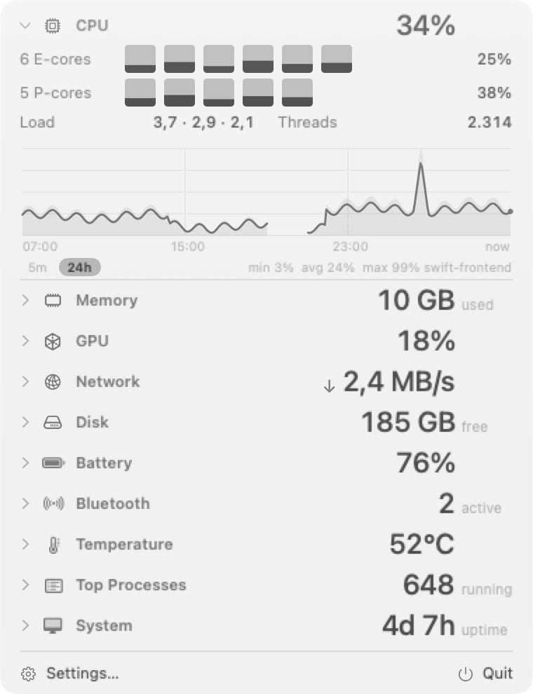
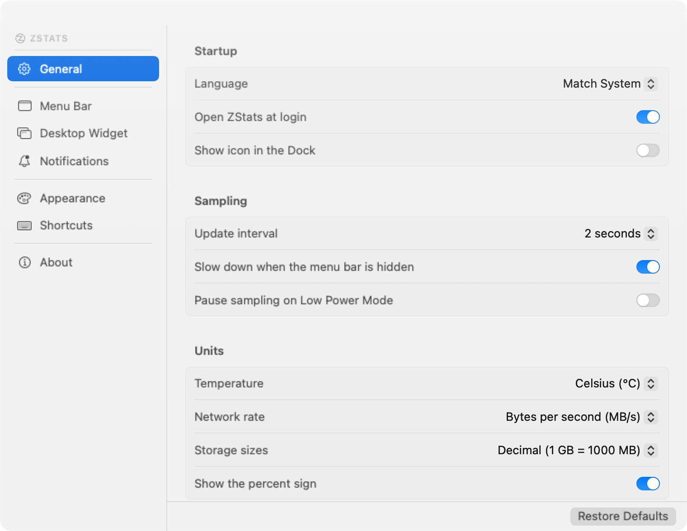

<div align="center">

<picture>
  <source media="(prefers-color-scheme: dark)" srcset="docs/logo-dark.png">
  
</picture>

<h3>ZStats</h3>

An ultra lightweight macOS system monitor.

<hr width="140">

</div>

**ZStats** is a lightweight, privacy-first system monitor for the Mac menu bar. It reads CPU, memory, GPU, network, disk, battery, Bluetooth peripherals, temperature, fan speeds, top processes, and host statistics directly from macOS system frameworks and displays them across three surfaces:

- **Menu bar** — combined or separate draggable status items, compact icon titles, stacked upload/download network rates, graphs, bars, and per-device Bluetooth battery readouts.
- **Click-down panel** — non-activating popover with accordion modules, live sparklines, and 24-hour history bands (with Liquid Glass on macOS 26+).
- **Desktop widget** — configurable floating or desktop-pinned telemetry card.

ZStats runs all day in a few megabytes of RAM and a fraction of a percent of one CPU core, with **zero third-party dependencies** and **no background auto-update checks**. Nothing ever leaves your Mac unless you explicitly turn on public IP lookup in Settings.

<div align="center">

<picture>
  <source media="(prefers-color-scheme: dark)" srcset="docs/panel-dark.png">
  
</picture>

<br><br>

<picture>
  <source media="(prefers-color-scheme: dark)" srcset="docs/settings-dark.png">
  
</picture>

</div>

## Highlights

- **Low overhead by construction** — reads directly from Mach, IOKit, `sysctl`, CoreWLAN, and IOBluetooth; collectors with no visible consumer or active alert rule stay suspended, and sampling pauses automatically when displays sleep or the screen locks.
- **Bluetooth peripheral tracking** — monitors connected Bluetooth headphones, mice, keyboards, trackpads, and gamepads, with support for pinning individual devices to dedicated menu bar battery readouts.
- **Bilingual UI** — switch live between **English** and **Tiếng Việt** (or follow macOS system language).
- **Threshold notifications & global shortcuts** — configurable sustained-duration alerts, custom metric palettes, and JSON settings import/export.
- **No telemetry or upstream updater** — self-contained universal binary (`arm64` + `x86_64`) with no background network polling.

## Requirements

- macOS 14 (Sonoma) or later
- Apple silicon (`arm64`) or Intel (`x86_64`)

## Build & Install

Clone the repository and build the universal `.app` bundle from source:

```sh
Scripts/build.sh release
cp -R .build/release/ZStats.app /Applications/
open /Applications/ZStats.app
```

`Scripts/build.sh` compiles both Apple silicon (`arm64`) and Intel (`x86_64`) slices, merges them into a single universal `ZStats.app` bundle, copies resources, and applies an ad-hoc signature so macOS grants menu bar status item privileges. Run `Scripts/build.sh` with no arguments for a debug bundle.

> **Upgrading from AirStats:** On first launch, ZStats automatically migrates any existing configuration and 24-hour chart history from `~/Library/Application Support/AirStats` into `~/Library/Application Support/ZStats` without modifying the old folder.

## CLI Diagnostics & Offscreen Rendering

The `ZStats` binary includes windowless verification modes that run over SSH or in CI without a display:

```sh
.build/debug/ZStats --probe                             # sample all collectors and print readings
.build/debug/ZStats --probe cpu bluetooth               # sample specific collectors
.build/debug/ZStats --render --out ./render             # render menuBar, panel, desktopWidget, and settings PNGs
.build/debug/ZStats --render settings --lang vietnamese # render in Vietnamese
```

## Source Layout

| Path | Description |
| --- | --- |
| `Sources/ZStatKit` | Collectors, sampling engine, history rings, localization, settings, and formatting. No UI imports. |
| `Sources/ZStatUI` | Menu bar drawing, click-down panel, desktop widget, settings window, charts, and design system. |
| `Sources/ZStats` | Executable entry point, app coordinator, `--probe` diagnostics CLI, and `--render` CLI. |
| `Tests/ZStatKitTests` | Collector contract tests, settings fault-tolerance tests, layout tests, and performance budgets. |
| `Scripts/build.sh` | Builds both CPU slices and assembles the universal `ZStats.app` bundle. |
| `Scripts/release.sh` | Signs, notarizes, and packages `ZStats.dmg` for distribution. |
| `Scripts/benchmark.py` | Measures live CPU and memory overhead against other running menu bar monitors. |

`ZStatKit` never imports SwiftUI or AppKit, keeping core collectors and unit tests fast and windowless.

## Contributing

See [CONTRIBUTING.md](CONTRIBUTING.md) for verification commands and codebase conventions.

## License

MIT. See [LICENSE](LICENSE).
